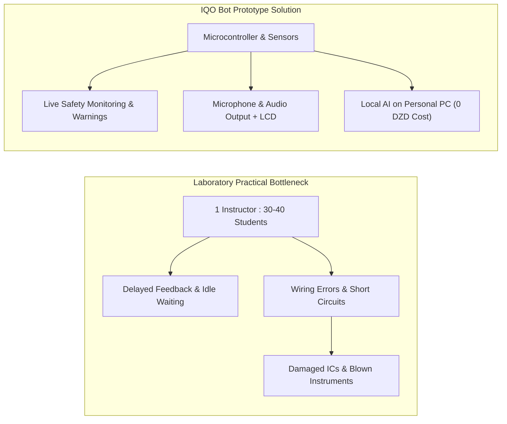
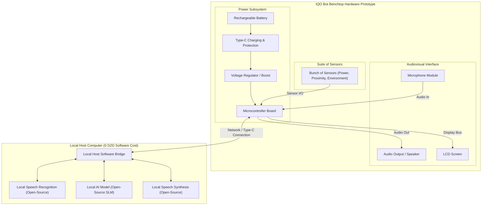

# FEASIBILITY STUDY REPORT
## Software Engineering Project — IEEE / ISO-based Template
### IQO Bot: Adaptive Multimodal Laboratory Assistant (University Project Prototype)

---

## Document Control

| Property | Value |
| :--- | :--- |
| **Project Title** | **IQO Bot: Adaptive Multimodal Laboratory Assistant (University Project Prototype)** |
| **Organisation / Client** | Faculty of Sciences and Technology / Department of Computer Science & Electrical Engineering |
| **Prepared By** | **Berbache Ayoub** [Student ID: ...] • **Filalli Yacine Siradj Eddin** [Student ID: ...] • **Malem Mohamed Mahdi** [Student ID: ...]<br>*(Software Engineering & Applied Intelligent Systems Module)* |
| **Academic Supervisor** | **Pr. Athmani.S** |
| **Version / Status** | **v1.0 — Submitted for Academic Module Review & Evaluation** |
| **Date** | [dd/mm/yyyy] |

---

## Revision History

| Version | Date | Author(s) | Description of Changes |
| :---: | :---: | :--- | :--- |
| **0.1** | [Date] | Berbache, Filalli, Malem | Initial feasibility concept and preliminary prototype component specifications. |
| **1.0** | [Date] | Berbache, Filalli, Malem | Complete feasibility study tailored strictly for the university prototype (microcontroller, mic, audio output, LCD screen, battery, Type-C port, network card, sensors, local zero-cost AI). |

---

## Table of Contents
1. [Executive Summary](#executive-summary)
2. [1. Introduction](#1-introduction)
   - [1.1 Purpose](#11-purpose)
   - [1.2 Scope](#12-scope)
   - [1.3 Definitions, Acronyms and Abbreviations](#13-definitions-acronyms-and-abbreviations)
   - [1.4 References](#14-references)
   - [1.5 Methodology of the Study](#15-methodology-of-the-study)
3. [2. System Overview](#2-system-overview)
   - [2.1 Current Situation and Problem Statement](#21-current-situation-and-problem-statement)
   - [2.2 Proposed Prototype Description](#22-proposed-prototype-description)
   - [2.3 System Objectives (SMART)](#23-system-objectives-smart)
   - [2.4 Stakeholders](#24-stakeholders)
   - [2.5 Alternatives Considered](#25-alternatives-considered)
4. [3. Feasibility Analysis (TELOS)](#3-feasibility-analysis-telos)
   - [3.1 Technical Feasibility](#31-technical-feasibility)
   - [3.2 Economic Feasibility](#32-economic-feasibility)
   - [3.3 Operational (Organisational) Feasibility](#33-operational-organisational-feasibility)
   - [3.4 Legal and Regulatory Feasibility](#34-legal-and-regulatory-feasibility)
   - [3.5 Schedule Feasibility](#35-schedule-feasibility)
5. [4. Risk Management Overview](#4-risk-management-overview)
6. [5. Overall Assessment and Recommendation](#5-overall-assessment-and-recommendation)
   - [5.1 Feasibility Summary](#51-feasibility-summary)
   - [5.2 Final Recommendation](#52-final-recommendation)
   - [5.3 Justification](#53-justification)
   - [5.4 Assumptions and Constraints](#54-assumptions-and-constraints)
7. [6. Approval](#6-approval)
8. [7. Appendices & Technical Reference](#7-appendices--technical-reference)
   - [Appendix A: Prototype Component Breakdown & Cost Tracking](#appendix-a-prototype-component-breakdown--cost-tracking)
   - [Appendix B: Prototype Electrical & Interfacing Architecture](#appendix-b-prototype-electrical--interfacing-architecture)
   - [Appendix C: Academic Work Breakdown & Milestones](#appendix-c-academic-work-breakdown--milestones)

---

## Executive Summary

This feasibility study evaluates the design, development, and validation of a functional proof-of-concept hardware prototype for the **IQO Bot** system as part of a university academic engineering project within the *Software Engineering & Applied Intelligent Systems* module, supervised by **Pr. Athmani.S**.

The project addresses critical challenges in university practical laboratory sessions (*Travaux Pratiques*), including high student-to-instructor supervision ratios (typically 30–40 students per instructor) and recurring laboratory hazards (e.g., breadboard short circuits, incorrect wiring, and component damage).

**Prototype Architecture & Technical Scope:**
The physical prototype is an interactive benchtop assistant built using standard educational electronic components:
1. **Embedded Microcontroller:** Central board governing peripheral I/O, sensor polling, audio communication, and display control.
2. **Audio Input (Microphone):** Captures spoken student questions at the laboratory workbench.
3. **Audio Output:** Provides spoken voice guidance and audible alerts.
4. **Visual Interface (LCD Screen):** Displays visual cues, status indicators, and instructional feedback.
5. **Rechargeable Battery & Type-C Port:** Provides portable bench power with convenient USB Type-C charging and serial communication.
6. **Network Card / Connectivity:** Enables local communication with a host computer for AI orchestration.
7. **Suite of Sensors:** A collection of laboratory sensors (e.g., current/voltage monitoring, presence/proximity sensing, environmental monitoring) to maintain situational awareness of bench conditions.
8. **Local Zero-Cost AI Core:** All AI model training, fine-tuning, and inference are executed **100% locally on existing personal/university computer hardware at exactly 0 DZD ($0.00)** in software licensing or cloud API costs.

**Feasibility Evaluation:**
Across the five TELOS dimensions (Technical, Economic, Legal, Operational, Schedule), the prototype is assessed as **FEASIBLE**. The financial outlay is strictly limited to tangible electronic components, all software tools and AI models are open-source with zero recurring fees, and the development timeline aligns with the academic semester schedule.

### Key Figures Summary

| Key Figure | Value |
| :--- | :--- |
| **Estimated Total Hardware Cost** | **[Amount in DZD to be determined based on prototype component purchases; 0 DZD for AI software]** |
| **AI Training & Software Licensing Cost** | **0 DZD ($0.00)** *(100% Local Open-Source Execution)* |
| **Student Development Labour** | **0 DZD** *(Academic Curriculum Project)* |
| **Estimated Project Duration** | **[Academic semester duration, e.g. 10–12 weeks]** |
| **Expected Payback Period** | **Not directly applicable** *(Academic student prototype; value realized in education & lab protection)* |
| **Overall Recommendation** | **PROCEED (Unconditional Go; practical, affordable, and academically sound)** |

---

## 1. Introduction

### 1.1 Purpose
This document establishes the formal feasibility study for designing, assembling, and experimentally demonstrating the **IQO Bot hardware prototype**. Conducted under the academic supervision of **Pr. Athmani.S**, this study evaluates the project across the **TELOS** framework (Technical, Economic, Legal, Operational, and Schedule feasibility) in accordance with IEEE/ISO software and systems engineering standards.

### 1.2 Scope

| Dimension | Description |
| :--- | :--- |
| **In Scope** | • **Embedded Microcontroller:** Core processing board managing real-time peripheral control and sensor polling.<br>• **Audiovisual Subsystem:** Microphone for speech capture, audio output (speaker/buzzer) for voice feedback, and LCD screen for visual feedback.<br>• **Power Management:** Rechargeable battery pack, USB Type-C charging port, and power regulation for workbench operation.<br>• **Network Connectivity:** Network card / module for local data exchange with the host machine.<br>• **Sensor Suite:** A collection of sensors for bench monitoring (e.g., power monitoring, distance/presence detection, ambient conditions).<br>• **Local Zero-Cost AI System:** 100% free local training and inference on existing student/laboratory computers using open-source models with $0 cloud API costs.<br>• **Chassis & Assembly:** Prototype breadboard/perfboard mounting and protective enclosure. |
| **Out of Scope** | • **Mass Industrial Manufacturing:** Production tooling and campus-wide deployment are deferred to future phases.<br>• **Paid Commercial Cloud APIs:** No paid subscription tokens (e.g. cloud LLMs); all models run locally offline.<br>• **Wheeled / Mobile Locomotion:** Deliberately excluded; the prototype is a stationary benchtop assistant to prevent mechanical instability near laboratory instruments. |
| **Intended Users** | • **Primary:** University academic evaluation jury, module supervisor (Pr. Athmani.S), and project team members.<br>• **Secondary:** Higher education laboratory students and instructors participating in demonstration sessions. |
| **Operating Environment** | • **Hardware Unit:** University laboratory workbench or student workstation desk.<br>• **Local AI Host:** Standard personal laptop or departmental PC running local open-source software.<br>• **Connectivity:** Local network (Wi-Fi / Ethernet) or direct USB Type-C connection; no public internet dependency. |

### 1.3 Definitions, Acronyms and Abbreviations

| Term | Definition |
| :--- | :--- |
| **Microcontroller** | Programmable integrated circuit governing sensors, display, and audio peripherals on the bench unit |
| **LCD** | Liquid Crystal Display (visual screen module for text, graphics, and status feedback) |
| **Type-C** | Universal Serial Bus Type-C interface used for 5V power charging and serial data communication |
| **Local AI** | Open-source artificial intelligence models running entirely on local computer hardware with zero external API fees |
| **BOM** | Bill of Materials (itemized schedule of hardware prototype components and acquisition costs) |
| **Prototype** | Initial working proof-of-concept hardware unit built for academic evaluation |
| **TELOS** | Technical, Economic, Legal, Operational, and Schedule feasibility framework |

### 1.4 References
- **IQO Bot Extended Report** (Athmani.S, Berbache A., Filalli Y., Malem M., 2026).
- **Course Guidelines for Software Engineering & Applied Intelligent Systems** (Supervised by Pr. Athmani.S).
- **Applicable University Laboratory Safety Guidelines**.
- **Law No. 18-07 of 10 June 2018** on the protection of personal data (Algerian Republic).
- **IEEE Std 1058** for Software Project Management Plans.

### 1.5 Methodology of the Study
The findings in this study were established through:
1. **Practical Session Analysis:** Reviewing higher education laboratory workflows, supervisor-to-student ratios, and common breadboard wiring errors.
2. **Project Specification Review:** Evaluating the project technical report (`iqo_bot_extended_report.pdf`) and academic module requirements.
3. **Hardware Requirement Assessment:** Defining the essential components for a functional benchtop prototype (microcontroller, mic, audio output, LCD screen, battery, Type-C, network card, sensors).
4. **Local AI Resource Verification:** Confirming the technical capability of executing open-source language and speech models locally on personal computers at $0 software cost.

---

## 2. System Overview

### 2.1 Current Situation and Problem Statement
In higher education laboratory practicals (*Travaux Pratiques*), an instructor typically oversees 30 to 40 students across 15 to 20 workbench stations. This structure leads to:
- **Instructional Delays:** Students frequently wait for assistance with basic component identification, pinout verification, or troubleshooting.
- **Equipment Hazards:** Inadvertent short circuits or incorrect wiring can damage breadboards, integrated circuits, and testing instruments.
- **High Cost of Commercial Systems:** Commercial robotic platforms are far too expensive for academic student bench allocation.

The proposed prototype provides an accessible, low-cost benchtop assistant that offers real-time safety monitoring, visual and audible guidance, and intelligent interactive assistance without ongoing cloud fees.



### 2.2 Proposed Prototype Description
The system consists of a compact physical prototype situated on the student workbench, interfaced with a local host computer:
- **Microcontroller:** Coordinates peripheral communication, sensor readings, display rendering, and audio I/O.
- **Audio Subsystem:** Microphone captures student voice queries; audio output (speaker/buzzer) provides spoken explanations and warning alerts.
- **Visual Display (LCD):** Presents visual cues, status icons, circuit hints, and instructional messages.
- **Power Subsystem:** Rechargeable battery with USB Type-C charging and power management circuitry for safe cordless operation.
- **Network Card / Connectivity:** Transmits sensor telemetry and audio streams to the local host machine over local network or USB serial.
- **Sensor Suite:** Monitors bench parameters (e.g., current/voltage safety limits, student proximity, ambient temperature).
- **Local AI Engine:** Open-source speech recognition and language reasoning models running locally on the student/university workstation at **zero cloud API expense**.



### 2.3 System Objectives (SMART)

| Type | Objective | Success Indicator |
| :--- | :--- | :--- |
| **Functional** | Assemble and validate a working hardware prototype integrating microcontroller, microphone, audio output, LCD screen, battery, Type-C port, network card, and sensors connected to local zero-cost AI. | Successful demonstration of voice interaction, LCD visual display, and sensor threshold alerts during practical test runs. |
| **Performance** | Provide responsive local speech and sensor feedback over local communication connection. | Interactive response time under acceptable real-time limits [e.g. < 1–2 s] using local host models. |
| **Strategic** | Complete the university project requirements within student budget constraints with $0 ongoing software fees. | Successful project delivery, physical demonstration, and defense for the academic module. |

### 2.4 Stakeholders

| Stakeholder | Role / Interest | Influence | Expectations |
| :--- | :--- | :---: | :--- |
| **Academic Supervisor (Pr. Athmani.S)** | Guides and evaluates the academic project. | **High** | Working physical prototype, engineering rigor, and clear documentation. |
| **Project Team Members** | Designs, builds, programs, and documents the prototype. | **High** | Feasible workload, accessible components, zero cloud expenses, successful defense. |
| **End Users (Students & Instructors)** | Potential users in practical lab sessions. | **Medium** | Helpful bench feedback, reliable safety alerts, and straightforward operation. |
| **Academic Department / Jury** | Evaluates academic deliverables and prototype defense. | **High** | Valid proof of concept, adherence to academic standards. |

### 2.5 Alternatives Considered

| Option | Description | Advantages | Drawbacks |
| :--- | :--- | :--- | :--- |
| **A. Pure Software Simulation** | Software-only assistant on screen without physical hardware. | Minimal financial cost; avoids wiring and circuit assembly. | No physical presence at bench; cannot interact with laboratory wiring or physical sensors. |
| **B. Commercial Robotics Platform** | Purchasing off-the-shelf educational robotics platforms. | Ready-made assembly and existing demo software. | Prohibitive cost for a student project; lack of flexibility; often requires paid cloud subscriptions. |
| **C. Custom University Prototype (Retained)** | Custom hardware prototype using microcontroller, mic, audio output, LCD, battery, Type-C, network card, sensors, and local zero-cost AI. | Affordable, tailored for laboratory bench assistance, zero cloud fees, hands-on learning. | Requires component sourcing, hardware assembly, and firmware integration by the team. |

**Retained Option:** **Option C** — Chosen to provide a working physical prototype meeting the project requirements with zero cloud costs and accessible educational hardware components.

---

## 3. Feasibility Analysis (TELOS)

### 3.1 Technical Feasibility

#### 3.1.1 Technology Assessment

| Component Area | Selected Approach | Justification | Team Mastery |
| :--- | :--- | :--- | :---: |
| **Microcontroller** | [Model to be selected by team, e.g. ESP32 / Arduino / RPi Pico family] | Affordable, abundant GPIOs for peripherals and sensors. | [Medium / High] |
| **Audio Subsystem** | Microphone module + Audio output (speaker/buzzer module) | Enables spoken voice interaction and audible safety cues. | [Medium / High] |
| **Visual Display** | LCD Screen module | Provides visual status, instructional text, and animated feedback. | [Medium / High] |
| **Power & Connectivity** | Rechargeable battery, USB Type-C port, Network card / module | Enables portable benchtop operation and local host communication. | [Medium / High] |
| **Sensor Suite** | Bunch of sensors (e.g. current/voltage, distance, environmental) | Enables real-time workbench monitoring and safety threshold detection. | [Medium / High] |
| **Local AI Software** | Local open-source AI models executed on personal/lab PC | Zero cloud API fees ($0), full data privacy, and reliable offline operation. | [Medium / High] |

#### 3.1.2 Technical Risks & Mitigation
- **Integration Complexity:** Interfacing standard microcontroller GPIOs, communication buses (I2C/SPI/UART), and connecting to a local host machine. Mitigated by testing each subsystem independently before full integration.
- **Scalability Limitations:** The initial scope is a single university project prototype; multi-station scaling would be addressed in future phases.
- **Security & Privacy:** 100% local processing eliminates external data transmission and guarantees privacy.

> **Technical Feasibility Verdict: ☑ FEASIBLE**  
> *The proposed prototype uses accessible embedded hardware and local open-source AI software running on existing personal/lab computers.*

---

### 3.2 Economic Feasibility

#### 3.2.1 Prototype Cost Breakdown

| Cost Category | One-off Cost (DZD) | Recurring Cost (DZD) | Basis of Estimate |
| :--- | :---: | :---: | :--- |
| **Student Development Labour** | **0 DZD** | — | Academic curriculum student project (no commercial labour charges). |
| **Prototype Hardware Components:**<br>• Microcontroller<br>• Microphone module<br>• Audio output module<br>• LCD screen<br>• Rechargeable battery<br>• USB Type-C port / charging board<br>• Network card / connectivity<br>• Bunch of sensors<br>• Prototyping breadboard & wiring accessories | **[Amount in DZD to be determined based on actual purchases / invoices]** | — | [Actual receipts from local electronic parts retailers / suppliers] |
| **AI Training, Inference & Software Licences** | **0 DZD ($0.00)** | **0 DZD ($0.00)** | **100% Free / Open Source; executed locally on existing student/university computer.** |
| **Testing Consumables & Buffer** | **[...]** | — | [Contingency buffer for testing wires, replacement components, etc.] |
| **TOTAL PROTOTYPE BUDGET** | **[Total in DZD to be confirmed by receipts]** | **0 DZD** | **Self-funded within student project allowances with zero software licensing costs.** |

#### 3.2.2 Benefit Analysis
- **Direct Tangible Benefits:** Protection of expensive laboratory instruments and components from accidental wiring destruction during practical experiments.
- **Software Cost Avoidance:** Zero cloud API subscription fees over the project development lifecycle.
- **Educational & Academic Value:** Substantial academic merit, mastery of embedded systems and applied AI, and successful completion of the university degree module.

#### 3.2.3 Economic Evaluation
Because this is an academic student project, traditional commercial return-on-investment (ROI) models do not directly apply. The project is economically sound because out-of-pocket expenses are confined strictly to basic electronic parts, software costs are exactly zero, and the educational return is high.

> **Economic Feasibility Verdict: ☑ FEASIBLE**  
> *The prototype budget is modest, software and AI costs are zero, and hardware expenses are limited to standard educational electronic components.*

---

### 3.3 Operational (Organisational) Feasibility

#### 3.3.1 Organisational Impact
- **Laboratory Workflow:** The assistant serves as a supplemental tool at the bench, providing real-time feedback and safety checks during practical sessions.
- **Required Training:** Minimal; straightforward user interaction via spoken voice and clear LCD visual prompts.
- **User Adaptation:** Non-invasive benchtop placement without obstructing student workspace tools.

#### 3.3.2 Stakeholder Acceptance & Operational Risks
- Stakeholder feedback will be gathered through prototype demonstrations during the academic term.
- Operational risks (e.g., loose wiring, sensor calibration) are managed through careful breadboarding and bench testing.

> **Operational Feasibility Verdict: ☑ FEASIBLE**  
> *The assistant is designed specifically for academic bench use with intuitive voice and visual feedback.*

---

### 3.4 Legal and Regulatory Feasibility

| Aspect | Applicable Rule / Regulation | Compliance Measure |
| :--- | :--- | :--- |
| **Data Protection & Privacy** | Law No. 18-07 of 10 June 2018 on the protection of personal data (Algeria) | 100% on-premises execution on local PC; zero transmission of audio or sensor telemetry outside the test bench; no persistent personal data stored. |
| **Intellectual Property** | University academic regulations on student projects | Student team retains project authorship under departmental supervision; open for academic evaluation. |
| **Software Licencing** | Open-source licensing compliance (MIT, Apache 2.0, BSD, Open Model licenses) | All utilized software frameworks and model weights permit free academic and non-commercial development. |
| **Electrical Safety** | Laboratory low-voltage safety standards | Low-voltage DC operation (typically 5V / 3.3V); battery protection against overcurrent and short circuits. |

> **Legal Feasibility Verdict: ☑ FEASIBLE**  
> *All processing is local with no external cloud data transmission (compliant with Law No. 18-07), and all libraries utilize permissive open-source licenses.*

---

### 3.5 Schedule Feasibility

#### 3.5.1 Project Timeline Overview

| Phase | Duration | Scope of Work |
| :--- | :---: | :--- |
| **Phase 1: Component Acquisition & Inception** | [e.g. 2 weeks] | Hardware component sourcing, specifications, and environment setup. |
| **Phase 2: Subsystem Prototyping** | [e.g. 3 weeks] | Wiring microcontroller, audio I/O, LCD screen, and sensor breadboarding. |
| **Phase 3: Power & Peripheral Integration** | [e.g. 2 weeks] | Battery management, Type-C charging integration, and firmware drivers. |
| **Phase 4: Local AI Host Integration** | [e.g. 2 weeks] | Local AI configuration on host PC, communication link, and speech loop. |
| **Phase 5: System Testing & Enclosure** | [e.g. 2 weeks] | Assembly, threshold testing, and performance validation on test circuits. |
| **Phase 6: Project Demonstration & Defense** | [e.g. 1 week] | Final report, demonstration to supervisor and academic jury. |

#### 3.5.2 Critical Path & Schedule Risk
- **Critical Path:** Hardware component acquisition → Embedded wiring & sensor interfacing → Local AI host configuration → Integration & testing → Final academic demonstration.
- **Schedule Risks:** Schedule risks are low given the focused scope of a single university prototype within the semester.

> **Schedule Feasibility Verdict: ☑ FEASIBLE**  
> *The project is structured to fit within standard academic semester timelines.*

---

## 4. Risk Management Overview

*Risk Level = Probability (1–3) × Impact (1–3): 1–2 Low, 3–4 Medium, 6–9 High.*

| ID | Description | Prob. | Impact | Level | Mitigation Strategy | Owner |
| :---: | :--- | :---: | :---: | :---: | :--- | :--- |
| **R1** | Component availability or delivery delays from local electronics suppliers. | 2 | 2 | **4 (Med)** | Source standard, widely available electronic components early in the project. | Team |
| **R2** | Local computer hardware performance limitations during AI inference. | 2 | 2 | **4 (Med)** | Select lightweight, quantized open-source models suitable for standard personal computers. | Team |
| **R3** | Power instability or wiring faults during breadboard assembly. | 2 | 2 | **4 (Med)** | Use regulated power supply modules, verify all pinouts before powering on, and utilize battery protection boards. | Team |

---

## 5. Overall Assessment and Recommendation

### 5.1 Feasibility Summary

| Dimension | Verdict | Key Finding |
| :--- | :---: | :--- |
| **Technical** | **FEASIBLE** | Accessible embedded hardware and local open-source AI software running on existing personal/lab computers. |
| **Economic** | **FEASIBLE** | Hardware costs limited to basic educational components; software and AI training costs are exactly 0 DZD. |
| **Operational** | **FEASIBLE** | Intuitive spoken and visual LCD interface designed specifically for laboratory workbench assistance. |
| **Legal** | **FEASIBLE** | Strict compliance with data protection laws via 100% offline local processing and permissive open-source licenses. |
| **Schedule** | **FEASIBLE** | Structured to fit within the standard academic semester schedule with parallel development tracks. |

### 5.2 Final Recommendation
- [x] **Proceed with the project**
- [ ] Proceed with modifications: [specify]
- [ ] Postpone until: [condition or date]
- [ ] Cancel the project

### 5.3 Justification
The feasibility analysis confirms that developing a working prototype using a microcontroller, audio I/O, LCD screen, battery, Type-C port, network card, and sensors with local, zero-cost AI is practical, affordable, and aligned with academic project requirements.

### 5.4 Assumptions and Constraints
- **Assumptions:** Team members have access to a personal computer capable of running local open-source models; components will be obtained from local or online electronics suppliers.
- **Constraints:** Prototype to be completed within the academic semester schedule and student budget limits.

---

## 6. Approval

| Role | Name | Signature | Date |
| :--- | :--- | :---: | :---: |
| **Prepared by (Project Team)** | **Berbache Ayoub**<br>**Filalli Yacine Siradj Eddin**<br>**Malem Mohamed Mahdi** | ________________________ | [dd/mm/yyyy] |
| **Reviewed by (Academic Supervisor)** | **Pr. Athmani.S** | ________________________ | [dd/mm/yyyy] |
| **Approved by (Module Jury / Department)** | **Faculty of Sciences and Technology** | ________________________ | [dd/mm/yyyy] |

---

## 7. Appendices & Technical Reference

### Appendix A: Prototype Component Breakdown & Cost Tracking

| Subsystem / Item | Description / Technical Role | Quantity | Unit Cost (DZD) | Total Cost (DZD) | Notes / Source |
| :--- | :--- | :---: | :---: | :---: | :--- |
| **Microcontroller Board** | Central embedded controller running firmware and peripheral I/O | 1 | [...] | [...] | [Store receipt / quote] |
| **Microphone Module** | Captures spoken voice input at the workbench | 1 | [...] | [...] | [Store receipt / quote] |
| **Audio Output Module** | Speaker / amplifier or buzzer for voice feedback and alerts | 1 | [...] | [...] | [Store receipt / quote] |
| **LCD Screen** | Visual display screen for status, text, and visual cues | 1 | [...] | [...] | [Store receipt / quote] |
| **Rechargeable Battery** | Battery pack for portable benchtop power | 1 | [...] | [...] | [Store receipt / quote] |
| **USB Type-C Interface** | Charging module / Type-C connector with protection | 1 | [...] | [...] | [Store receipt / quote] |
| **Network Card / Connectivity** | Network card / module for local communication with host PC | 1 | [...] | [...] | [Store receipt / quote] |
| **Sensor Suite** | Bunch of sensors for bench monitoring (power, distance, etc.) | 1 kit | [...] | [...] | [Store receipt / quote] |
| **Prototyping Accessories** | Breadboard, jumper wires, passive components, mounting | 1 set | [...] | [...] | [Store receipt / quote] |
| **AI Software & Models** | Local open-source AI models & speech engines | — | **0 DZD** | **0 DZD** | 100% Free / Open Source |
| **TOTAL ESTIMATED HARDWARE** | **Complete Prototype Component Budget** | — | — | **[...] DZD** | **To be finalized based on actual receipts** |

### Appendix B: Prototype Electrical & Interfacing Architecture

```
Prototype Architecture Block Diagram:
┌────────────────────────────────────────────────────────────────────────┐
│                        Embedded Microcontroller                        │
└──────┬──────────────┬──────────────┬──────────────┬──────────────┬─────┘
       │ Audio Input  │ Audio Output │ Display Bus  │ Sensor Bus   │ Network / Serial
       ▼              ▼              ▼              ▼              ▼
  ┌─────────┐    ┌─────────┐    ┌─────────┐    ┌─────────┐    ┌─────────┐
  │ Micro-  │    │  Audio  │    │   LCD   │    │ Bunch of│    │ Network │
  │  phone  │    │ Output  │    │ Screen  │    │ Sensors │    │  Card   │
  └─────────┘    └─────────┘    └─────────┘    └─────────┘    └────┬────┘
                                                                   │
       ┌───────────────────────────────────────────────────────────┴────┐
       │ Power Subsystem: Battery → Type-C Port & Charger → Regulator   │
       └────────────────────────────────────────────────────────────────┘
                                   │
                                   ▼ Local Connection (Wi-Fi / Serial)
       ┌────────────────────────────────────────────────────────────────┐
       │ Host Computer: Local AI Training & Inference ($0 Cloud Cost)   │
       └────────────────────────────────────────────────────────────────┘
```

### Appendix C: Academic Work Breakdown & Milestones

| Milestone | Target Horizon | Deliverable / Success Criteria |
| :---: | :--- | :--- |
| **M1: Inception & Sourcing** | [Weeks 1–2] | Acquisition of prototype components (microcontroller, mic, audio output, LCD, battery, Type-C, network card, sensors); environment setup. |
| **M2: Subsystem Bring-Up** | [Weeks 3–4] | Verified operation of microcontroller with audio I/O, LCD screen, and initial sensor readings on breadboard. |
| **M3: Power & Integration** | [Weeks 5–6] | Battery and Type-C charging integration; sensor monitoring loop active. |
| **M4: Local AI Host Link** | [Weeks 7–8] | Local open-source AI running on host PC communicating with prototype ($0 cost). |
| **M5: Prototype Validation** | [Weeks 9–10] | Enclosure assembly and end-to-end testing of bench assistance and safety alerts. |
| **M6: Final Academic Defense**| [Weeks 11–12]| Demonstration of working prototype and report presentation before Pr. Athmani.S and academic jury. |
