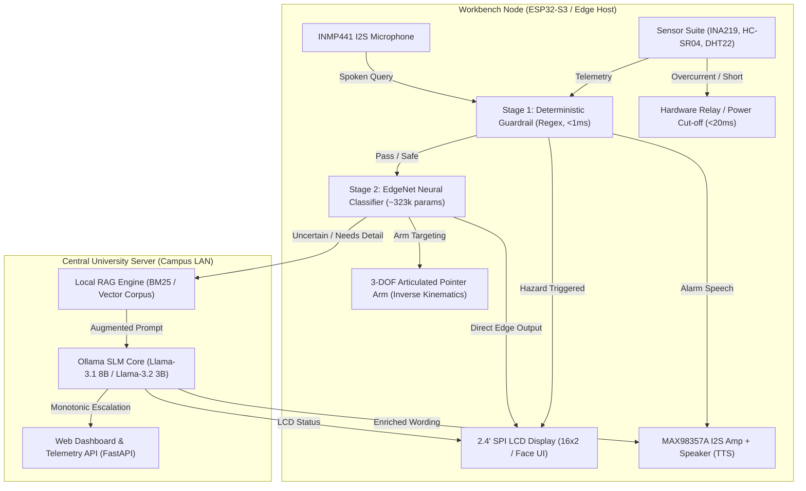
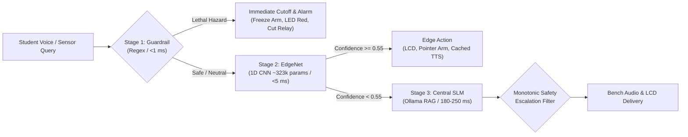

# IQO Bot: Adaptive Multimodal Laboratory Assistant

<p align="center">
  
  
  
  
  
  
  
</p>

---

## 1. Executive Summary & Problem Statement

Higher-education laboratory sessions (*Travaux Pratiques*) across physical sciences and engineering curricula face three persistent operational challenges:

1. **High Student-to-Instructor Ratio:** A single instructor typically supervises 30 to 40 students simultaneously across 15 to 20 workbench stations, causing instructional bottlenecks and delayed student feedback during critical procedures.
2. **Laboratory Safety & Equipment Hazards:** Inexperienced students regularly risk personal injury or hardware destruction due to breadboard power short circuits, reversed component polarities, blown multimeter fuses, or hazardous chemical reagent combinations.
3. **Prohibitive Adoption Costs:** Commercial laboratory automation systems cost upwards of \$1,000–\$2,500 per bench, making university-wide adoption economically infeasible.

### The IQO Bot Solution
**IQO Bot** is an adaptive, multimodal, benchtop laboratory assistant designed to provide real-time, non-invasive pedagogical guidance and active hazard prevention. By decoupling perception and actuation from neural reasoning:
- **Central University Server (AI Core):** Hosts quantized open-source Small Language Models (LLaMA-3.1 8B, LLaMA-3.2 3B, Qwen-2.5) via Ollama over the local area network (LAN) at **0 DZD (\$0.00)** recurring cloud API cost.
- **Distributed Low-Cost Workbench Client Nodes (~14,800 DZD / ~$109 USD BOM):** Compact microcomputing nodes (ESP32-S3 / Raspberry Pi 4) featuring an INA219 short-circuit detector (<20ms cutoff), I2S digital microphone, 3W voice speaker, 2.4" SPI TFT LCD, sensor suite, and an articulated 3-DOF robotic pointer arm.



---

## 2. Multi-Tier AI Reasoning Pipeline

Safety in university laboratories cannot rely solely on generative LLMs due to hallucination risks. IQO Bot implements a strictly tiered three-stage pipeline:



1. **Stage 1: Deterministic Real-Time Guardrail (`guardrail.py`):**
   - Pre-compiled regular expressions execute in **<1 ms** on microcontrollers.
   - Evaluates life-safety risks with zero tolerance (e.g. lethal gas mixtures, live mains probing, water poured into concentrated acid, LiPo battery thermal runaway).
   - Instantly triggers acoustic sirens, LCD emergency banners, and electrical relay disconnects.
2. **Stage 2: Edge Neural Classifier (`EdgeChemNet` / `EdgeElecNet` ~323k parameters):**
   - Lightweight 1D CNN multi-head architecture running on CPU via ONNX Runtime (<5 ms) or embedded C on ESP32-S3 (<2 ms).
   - Simulates multi-task predictions: Domain Topic, Safety Severity (`SAFE`, `WARNING`, `CRITICAL`), LED Beacon state, Pedagogical Intent, and 3-DOF Arm Kinematics (`pan`, `tilt`, `reach_cm`).
3. **Stage 3: Central Server Small Language Model (`brain.py` / Ollama):**
   - Leverages `llama3.2:3b` or `llama3.1:8b` via Ollama HTTP API with domain system prompts and Local RAG retrieval (`chem_core.md`, `elec_core.md`).
   - **Monotonic Safety Escalation Principle:** The central LLM can elevate safety warnings, but is mathematically and logically prohibited from downgrading a safety classification assigned by Stage 1 or Stage 2.

---

## 3. Dual Domain Specializations

The project contains two self-contained, domain-specific intelligence packages:

### 🧪 Chemistry Pack (`chem/`)
- **Focus:** General chemistry wet labs, titration, stoichiometry, chemical compatibility, reagent storage, and emergency eyewash protocols.
- **Key Capabilities:**
  - Real-time molarity and dilution calculations ($C_1 V_1 = C_2 V_2$).
  - Detection of prohibited reactions (e.g., Bleach + Ammonia $\rightarrow$ chloramine; Bleach + Acid $\rightarrow$ toxic chlorine gas; Cyanide + Acid $\rightarrow$ lethal HCN; Nitric Acid + Organics $\rightarrow$ explosion; Water into concentrated acid $\rightarrow$ thermal eruption).
  - GHS pictograms, chemical waste segregation, and PPE enforcement.
- **Service Profile:** Docker project `iqo-chem`, web dashboard on port `8081`, Ollama model `iqo-chem`.

### ⚡ Electronics Pack (`elec/`)
- **Focus:** DC/AC circuits, breadboard troubleshooting, component identification, multimeter/oscilloscope guidance, and power supply safety.
- **Key Capabilities:**
  - Circuit analysis: Ohm's law ($V = I R$), resistor E12 series color codes, LED series resistors, RC filter time constants ($\tau = R C$), transistor switching ratios.
  - Hardware hazard detection: INA219 current monitoring with instant short-circuit trip (<20 ms), reverse polarity warning, electrolytic capacitor overvoltage, LiPo battery swelling/puncture mitigation.
  - Mains voltage isolation warning: strictly prohibits student live mains probing (>50V AC / 120V DC).
  - 3-DOF articulated pointer arm directing students to specific breadboard rails or multimeter sockets.
- **Service Profile:** Docker project `iqo-elec`, web dashboard on port `8082`, Ollama model `iqo-elec`.

---

## 4. Hardware Prototype & Bill of Materials (BOM)

The physical prototype is an interactive, battery-powered bench unit built with standardized educational electronics:

| Component | Technical Specification | Function in IQO Bot | Est. Cost (DZD) |
| :--- | :--- | :--- | :---: |
| **ESP32-S3 DevKit-C** | Dual-core Xtensa LX7, 8MB PSRAM, Wi-Fi 4 / BLE 5 | Central client controller, runs FreeRTOS & embedded C inference | 3,800 DZD |
| **INMP441 Microphone** | Omnidirectional I2S digital MEMS microphone | Near-field spoken question capture with noise cancellation | 950 DZD |
| **MAX98357A + Speaker** | I2S Class D 3W audio amplifier + 4Ω dynamic speaker | Voice guidance and audible alarms (up to 75 dB SPL) | 1,300 DZD |
| **2.4" SPI TFT LCD** | ST7789 controller, 240×320 resolution, 25+ FPS | Visual feedback, 16×2 text display, status icons, circuit diagrams | 2,200 DZD |
| **INA219 Sensor** | I2C bidirectional high-side current and voltage sensor | Sub-20ms bench short-circuit and overcurrent detection | 900 DZD |
| **HC-SR04 Proximity** | Ultrasonic range finder (2 cm – 400 cm) | Student presence and desk arrival detection | 400 DZD |
| **DHT22 Sensor** | Capacitive digital humidity and temperature sensor | Ambient lab environment and thermal runaway monitoring | 800 DZD |
| **3-DOF Pointer Arm** | 3x MG90S metal-gear micro servos + inverse kinematics | Physical pointing to reagents, test points, or multimeter jacks | 1,350 DZD |
| **Power Management** | 18650 Li-ion 2500mAh + TP4056 Type-C + MT3608 boost | Autonomous operation ($\ge 3.5$ hours continuous runtime) | 1,550 DZD |
| **Relay & Passives** | Optocoupler relay, resistors, LDR, solderless breadboard | Power rail disconnect circuit and analog light sensing | 1,200 DZD |
| **3D Printed Chassis** | PETG / PLA custom desktop mounting enclosure | Protective housing with acoustic chamber and servo mount | 650 DZD |
| **Total Hardware Cost**| **Standalone Physical Benchtop Prototype** | — | **14,800 DZD (~$109 USD)** |
| **Software & AI Licensing** | **PyTorch, Ollama, Whisper.cpp, Piper, Linux/FreeRTOS** | **100% Local Open-Source Execution** | **0 DZD ($0.00)** |

---

## 5. Docker AI Infrastructure & Microservices

Both domain packs are containerized with multi-stage Dockerfiles and Docker Compose profiles:

```
├── chem/
│   ├── Dockerfile                  # Lightweight Python 3.11 runtime (PyTorch CPU, ONNX, HuggingFace)
│   ├── docker-compose.yml          # Services: ollama, llm-init, trainer, web
│   └── llm/Modelfile               # Ollama system prompt, parameters, chemistry persona
├── elec/
│   ├── Dockerfile                  # Electronics Python 3.11 runtime
│   ├── docker-compose.yml          # Services: ollama, llm-init, trainer, web
│   └── llm/Modelfile               # Electronics persona and bench safety guidelines
└── Dockerfile                      # Root unified training and chat runtime
```

### Quickstart Commands

#### 1. Running the Chemistry Assistant (Web UI on :8081)
```bash
cd chem
# Start Ollama and initialize the specialized iqo-chem model
docker compose up -d

# (Optional) Train EdgeChemNet and export fresh artifacts to ./artifacts
docker compose --profile train run --rm trainer

# Launch the web dashboard on http://localhost:8081
docker compose --profile run up -d web
```

#### 2. Running the Electronics Assistant (Web UI on :8082)
```bash
cd elec
# Start Ollama (host port 11435) and create iqo-elec model
docker compose up -d

# (Optional) Train EdgeElecNet and export embedded C header
docker compose --profile train run --rm trainer

# Launch the web dashboard on http://localhost:8082
docker compose --profile run up -d web
```

---

## 6. Microcontroller C Header Export

IQO Bot features an automated export tool (`export.py`) that converts trained PyTorch neural networks into:
1. `edge_*_net.pt` (TorchScript module for local Python inference).
2. `edge_*_net.onnx` (High-speed CPU inference via ONNX Runtime).
3. `edge_*_net_quantized.pt` (INT8 dynamic-quantized PyTorch module).
4. `iqo_*_embedded_config.h` (Static C header containing INT8 symmetric weights, FP32 scales, and inverse kinematics coordinate arrays).

This allows the neural network to be compiled directly into **ESP-IDF** or **Arduino C++** on the ESP32-S3 without requiring TensorFlow Lite or external runtime interpreters.

---

## 7. Project Structure

```
├── .licenses/                      # Component open-source licenses
├── artifacts/                      # Exported models (.onnx, .pt, .h) & RAG indices
├── chem/                           # Specialized Chemistry Pack
│   ├── artifacts/                  # Chemistry model checkpoints & embedded headers
│   ├── dev/                        # Developer tests (selftest.py, eval.py)
│   ├── finetune/                   # LoRA fine-tuning & SFT dataset generators
│   ├── knowledge/                  # Markdown knowledge bases (chem_core.md)
│   ├── llm/                        # Ollama Modelfile & initialization scripts
│   ├── brain.py                    # Ollama client with monotonic safety escalation
│   ├── config.py                   # Tokenizer, LED, and LCD constants
│   ├── dashboard.py                # Terminal interactive dashboard
│   ├── data_gen.py                 # Synthetic training data generator
│   ├── docker-compose.yml          # Multi-container orchestration
│   ├── Dockerfile                  # Container definition
│   ├── engine.py                   # 3-Stage runtime pipeline (Guardrail -> EdgeNet -> LLM)
│   ├── export.py                   # ONNX, TorchScript & C header exporter
│   ├── guardrail.py                # Sub-millisecond deterministic safety filter
│   ├── ingest_hf.py                # Hugging Face dataset retriever
│   ├── model.py                    # EdgeChemNet PyTorch architecture
│   ├── topics.py                   # Chemistry topics and kinematics targets
│   ├── train.py                    # Model training loop
│   └── web_dashboard.py            # Dark-mode web interface & REST API (:8081)
├── elec/                           # Specialized Electronics Pack
│   ├── dev/                        # Electronics selftest scripts
│   ├── knowledge/                  # Circuit & electronics knowledge base (elec_core.md)
│   ├── llm/                        # Ollama Modelfile (iqo-elec)
│   ├── brain.py                    # Ollama client with safety escalation
│   ├── config.py                   # Electronics configuration & arm zones
│   ├── data_gen.py                 # Electronics synthetic data generator
│   ├── docker-compose.yml          # Container configuration (ports 8082, 11435)
│   ├── Dockerfile                  # Container definition
│   ├── engine.py                   # Electronics runtime pipeline
│   ├── guardrail.py                # Live mains & LiPo battery guardrails
│   ├── model.py                    # EdgeElecNet architecture
│   ├── topics.py                   # Electronics topics and kinematics targets
│   ├── train.py                    # Training loop
│   └── web_dashboard.py            # Dark-mode web interface & REST API (:8082)
├── docs/                           # Extended Technical Documentation
│   ├── ARCHITECTURE.md             # Theoretical foundations, latency budgets & kinematics
│   ├── HARDWARE_SPECIFICATION.md   # Schematics, pinout matrix & power analysis
│   ├── DOCKER_AI_GUIDE.md          # Multi-container setup, GPU configuration & LoRA
│   └── API_AND_EMBEDDED.md         # REST API endpoints & ESP32 C integration
├── FEASIBILITY_STUDY_EQO_BOT.md    # IEEE/ISO-based TELOS feasibility study
├── SPRINT_0_BACKLOG.md             # Agile Sprint 0 backlog and inception plan
├── report_text.txt                 # Extracted text of extended academic report
├── iqo_bot_extended_report.pdf     # Formal academic extended report (English)
├── iqo_bot_extended_report_ar.pdf  # Formal academic extended report (Arabic)
├── 1 Student Project Sheet Template.docx # Student project proposal sheet
├── central_brain.py                # Central chat router with RAG
├── central_chat.py                 # Unified CLI chat interface
└── docker-compose.yml              # Root container configuration
```

---

## 8. Academic Project Control & Authors

This project is developed as part of the **Software Engineering & Applied Intelligent Systems** module within the Faculty of Sciences and Technology, Department of Computer Science & Electrical Engineering.

- **Academic Supervisor:** **Pr. Athmani.S**
- **Project Members:**
  - **Berbache Ayoub** ([@ayoubberbache](https://github.com/ayoubberbache)) — *AI Models, Neural Architecture, Brain Logic, 3D Mechanical Assembly*
  - **Filalli Yacine Siradj Eddin** — *Server & Robot Routing, Network Security Systems, Hardware Assembly*
  - **Malem Mohamed Mahdi** — *Dashboard UI/UX, SQLite Database Configuration, Dataset Gathering*

---

## 9. Further Reading & Documentation

- [System Architecture & Theoretical Foundations](docs/ARCHITECTURE.md)
- [Hardware Schematics & Pinout Mapping](docs/HARDWARE_SPECIFICATION.md)
- [Docker AI Containers & LoRA Fine-Tuning Guide](docs/DOCKER_AI_GUIDE.md)
- [REST API Reference & Embedded C Integration](docs/API_AND_EMBEDDED.md)
- [TELOS Feasibility Study Report](FEASIBILITY_STUDY_EQO_BOT.md)
- [Agile Sprint 0 Backlog](SPRINT_0_BACKLOG.md)

---

<p align="center">
  <b>IQO Bot</b> • Built with precision for safer, smarter university science laboratories.
</p>
