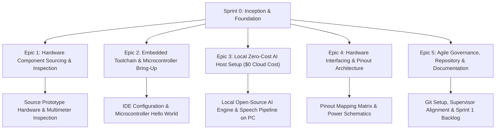

# SPRINT 0 BACKLOG & INCEPTION PLAN
## Software Engineering & Applied Intelligent Systems Module
### Project: IQO Bot — Adaptive Multimodal Laboratory Assistant (Hardware Prototype)

---

## 1. Sprint 0 Overview & Objectives

| Property | Details |
| :--- | :--- |
| **Project Title** | **IQO Bot: Adaptive Multimodal Laboratory Assistant (Hardware Prototype)** |
| **Sprint Number** | **Sprint 0: Inception, Component Sourcing & Environment Bring-Up** |
| **Sprint Duration** | **2 Weeks** (Academic Semester Inception: Weeks 1–2) |
| **Project Team** | **Berbache Ayoub** • **Filalli Yacine Siradj Eddin** • **Malem Mohamed Mahdi** |
| **Academic Supervisor** | **Pr. Athmani.S** |
| **Sprint Goal** | Establish the physical, electronic, software, and governance foundation for the IQO Bot prototype by acquiring the specified hardware components (microcontroller, mic, audio output, LCD screen, battery, Type-C port, network card, sensors), bringing up embedded toolchains, configuring the 100% free local AI host pipeline ($0 cost) on personal computers, and establishing the project repository and pinout architecture. |
| **Estimated Sprint Capacity** | **~30–35 Story Points** (Equally balanced across the 3 team members) |

---

## 2. Sprint 0 Epic Breakdown

---

## 3. Detailed Sprint 0 Product Backlog Items (PBI)

### Epic 1: Hardware Component Sourcing & Electrical Inspection (HW-PROC)

#### `TASK-001`: Prototype Hardware Component Sourcing & Acquisition
- **Type:** Procurement / Enabler
- **Priority:** Must Have (P0)
- **Story Points:** 5
- **Assigned To:** Malem Mohamed Mahdi (Supported by Team)
- **Description:** Locate and acquire the required electronic components for the university prototype from local electronics suppliers or academic lab stocks according to the prototype bill of materials.
- **Scope Checklist:**
  - [ ] Microcontroller board [e.g. ESP32 / Arduino / RPi Pico or team-selected board `[...]`].
  - [ ] Microphone module [e.g. digital/analog microphone module `[...]`].
  - [ ] Audio output module [e.g. mini speaker / amplifier / buzzer `[...]`].
  - [ ] LCD screen module [e.g. SPI / I2C / parallel LCD display `[...]`].
  - [ ] Rechargeable battery [e.g. Li-ion cell / battery pack `[...]`].
  - [ ] USB Type-C port / charging board [e.g. Type-C charger module with protection `[...]`].
  - [ ] Network card / connectivity module [e.g. integrated Wi-Fi or network module `[...]`].
  - [ ] Bunch of sensors for bench monitoring [e.g. voltage/current sensor, distance sensor, environmental sensors `[...]`].
  - [ ] Prototyping solderless breadboard, jumper wire set (M-M, M-F), resistors, and passive accessories.
- **Acceptance Criteria:**
  - *Given* the prototype component specifications,
  - *When* components are collected,
  - *Then* all physical parts are accounted for and actual purchase receipts are archived for project accounting (`[...] DZD`).

---

#### `TASK-002`: Component Visual & Multimeter Electrical Inspection
- **Type:** Quality Assurance / Verification
- **Priority:** Must Have (P0)
- **Story Points:** 2
- **Assigned To:** Malem Mohamed Mahdi
- **Description:** Perform initial physical and electrical checks with a multimeter before powering any board to prevent accidental component damage.
- **Scope Checklist:**
  - [ ] Inspect board headers and sensor breakout pins for manufacturing solder bridges or bent pins.
  - [ ] Verify battery open-circuit cell voltage with a digital multimeter.
  - [ ] Test power regulation/converter module output under no-load condition to confirm correct voltage rails (e.g. 5.0V / 3.3V).
- **Acceptance Criteria:**
  - *Given* the acquired hardware components,
  - *When* tested with a digital multimeter,
  - *Then* no short circuits exist across VCC-GND rails, and regulated outputs are verified within safe operating tolerances.

---

#### `TASK-003`: Power Subsystem Bring-Up & Type-C Charging Test
- **Type:** Hardware Spike
- **Priority:** Must Have (P0)
- **Story Points:** 2
- **Assigned To:** Berbache Ayoub
- **Description:** Wire the rechargeable battery to the USB Type-C charging module and verify charging and power delivery to the system rail.
- **Scope Checklist:**
  - [ ] Connect battery terminals to charging module inputs.
  - [ ] Connect standard 5V USB Type-C supply and verify charging indicator illumination.
  - [ ] Verify charging cut-off behavior and check voltage regulation under dummy load.
- **Acceptance Criteria:**
  - *Given* the rechargeable battery and Type-C charging circuit,
  - *When* plugged into a standard 5V USB Type-C power source,
  - *Then* the circuit charges safely without abnormal heating and supplies regulated power.

---

### Epic 2: Embedded Toolchain & Microcontroller Bring-Up (EMB-SETUP)

#### `TASK-004`: Embedded Development IDE & Toolchain Environment Setup
- **Type:** Infrastructure / Setup
- **Priority:** Must Have (P0)
- **Story Points:** 2
- **Assigned To:** Malem Mohamed Mahdi
- **Description:** Set up and configure the unified embedded programming environment across the team’s computers.
- **Scope Checklist:**
  - [ ] Install embedded development IDE (e.g. VS Code with PlatformIO or vendor SDK/IDE).
  - [ ] Install required USB-to-UART / serial communication drivers for the microcontroller board.
  - [ ] Configure standard project template with target board definitions and compiler flags.
- **Acceptance Criteria:**
  - *Given* a team developer workstation,
  - *When* compiling a blank template project,
  - *Then* the compilation completes with zero errors and matches the project configuration.

---

#### `TASK-005`: Microcontroller Hardware Bring-Up & "Hello World" Smoke Test
- **Type:** Verification / Spike
- **Priority:** Must Have (P0)
- **Story Points:** 2
- **Assigned To:** Malem Mohamed Mahdi
- **Description:** Flash baseline firmware onto the microcontroller board to verify programming over USB Type-C, clock operation, and serial telemetry.
- **Scope Checklist:**
  - [ ] Write a baseline program (e.g., LED heartbeat toggle and periodic serial message).
  - [ ] Flash firmware over the USB data interface.
  - [ ] Open serial monitor console to verify diagnostic telemetry streaming.
- **Acceptance Criteria:**
  - *Given* the programmed microcontroller board,
  - *When* connected to the PC via USB,
  - *Then* the serial monitor displays startup messages and heartbeat indicators cleanly.

---

#### `TASK-006`: Sensor Bus Scanner & Initial Peripheral Detection
- **Type:** Embedded Spike
- **Priority:** Should Have (P1)
- **Story Points:** 3
- **Assigned To:** Berbache Ayoub
- **Description:** Create diagnostic firmware to verify communication bus connectivity (e.g. I2C / SPI / GPIO) and confirm sensor addressing.
- **Scope Checklist:**
  - [ ] Wire prototype communication lines between microcontroller and available sensor modules on breadboard.
  - [ ] Run communication bus sweep sketch to detect connected hardware addresses.
  - [ ] Document detected module addresses and signal integrity.
- **Acceptance Criteria:**
  - *Given* sensors wired to the microcontroller on the breadboard,
  - *When* the bus scanner firmware executes,
  - *Then* it correctly identifies the connected sensor peripheral addresses on the serial monitor.

---

### Epic 3: Local Zero-Cost AI Host Setup (AI-HOST)

#### `TASK-007`: Host Workstation Python & AI Development Environment Setup
- **Type:** Infrastructure / Setup
- **Priority:** Must Have (P0)
- **Story Points:** 2
- **Assigned To:** Filalli Yacine Siradj Eddin
- **Description:** Configure the local AI development environment on student laptops/workstations to execute open-source models 100% offline at exactly $0 cost.
- **Scope Checklist:**
  - [ ] Set up Python environment (`venv` / `conda`).
  - [ ] Install open-source machine learning and API libraries (e.g., PyTorch, FastAPI, WebSockets).
  - [ ] Establish environment dependency lockfile (`requirements.txt`).
- **Acceptance Criteria:**
  - *Given* a student workstation,
  - *When* running environment verification scripts,
  - *Then* all packages import cleanly without missing dependency warnings.

---

#### `TASK-008`: Local Open-Source AI Language Model Deployment & Benchmark
- **Type:** AI Spike / Verification
- **Priority:** Must Have (P0)
- **Story Points:** 3
- **Assigned To:** Filalli Yacine Siradj Eddin
- **Description:** Install and benchmark a quantized open-source language model running locally on the personal computer with zero cloud API fees.
- **Scope Checklist:**
  - [ ] Install local execution engine (e.g., Ollama / llama.cpp / HuggingFace Transformers).
  - [ ] Pull and test a lightweight, quantized open-source model suitable for consumer hardware.
  - [ ] Benchmark prompt response latency on laboratory assistant queries.
- **Acceptance Criteria:**
  - *Given* an offline personal computer,
  - *When* an educational lab prompt is submitted to the local AI engine,
  - *Then* an accurate contextual response is generated locally with exactly 0 DZD in API costs.

---

#### `TASK-009`: Local Open-Source Speech Processing Pipeline Setup
- **Type:** AI Spike / Verification
- **Priority:** Must Have (P0)
- **Story Points:** 3
- **Assigned To:** Filalli Yacine Siradj Eddin
- **Description:** Set up a lightweight, local speech-to-text (STT) and text-to-speech (TTS) pipeline on the host machine to support voice interaction.
- **Scope Checklist:**
  - [ ] Configure local open-source speech recognition tool (e.g. Whisper.cpp / local speech model).
  - [ ] Test speech transcription on sample laboratory audio clips.
  - [ ] Configure local text-to-speech engine for spoken response playback.
- **Acceptance Criteria:**
  - *Given* recorded sample audio of a student question,
  - *When* processed by the local speech pipeline,
  - *Then* the spoken audio is accurately transcribed to text on the local computer without internet access.

---

### Epic 4: Hardware Interfacing & Pinout Architecture (ARCH-PIN)

#### `TASK-010`: Microcontroller Pinout Allocation & Peripheral Bus Mapping
- **Type:** Architecture / Design
- **Priority:** Must Have (P0)
- **Story Points:** 3
- **Assigned To:** Berbache Ayoub & Malem Mohamed Mahdi
- **Description:** Formulate a conflict-free GPIO and bus allocation table for the microcontroller, mapping pins for microphone, audio output, LCD screen, network card, and sensors.
- **Scope Checklist:**
  - [ ] Map dedicated pins for audio input (microphone interface).
  - [ ] Map dedicated pins for audio output (speaker / amplifier / buzzer interface).
  - [ ] Map communication pins for the LCD screen (data/control lines).
  - [ ] Map sensor communication bus lines (e.g. I2C / SPI / analog / digital GPIOs).
  - [ ] Verify that bootstrapping and system-critical pins remain free of conflicting external pull-ups.
- **Acceptance Criteria:**
  - *Given* all component technical documentation,
  - *When* the pinout matrix is defined,
  - *Then* there are no pin conflicts, overlapping bus assignments, or bootstrapping violations.

---

#### `TASK-011`: Power Distribution & Interconnection Wiring Schematic
- **Type:** Architecture / Hardware Design
- **Priority:** Must Have (P0)
- **Story Points:** 2
- **Assigned To:** Berbache Ayoub
- **Description:** Draw the breadboard wiring schematic detailing power connections, voltage regulation, and signal paths between the microcontroller and all peripheral modules.
- **Scope Checklist:**
  - [ ] Document 5V and 3.3V power rails and ground distribution.
  - [ ] Include decoupling/filtering capacitors to maintain power stability.
  - [ ] Document wiring diagram in schematic format (e.g. KiCad / Fritzing).
- **Acceptance Criteria:**
  - *Given* the drafted schematic diagram,
  - *When* reviewed by the team,
  - *Then* power rails and signal lines are clearly labeled and verified safe for breadboard assembly.

---

### Epic 5: Agile Governance, Repository & Documentation (DOC-GOV)

#### `TASK-012`: Git Repository, Directory Structure & Version Control Setup
- **Type:** Governance / Infrastructure
- **Priority:** Must Have (P0)
- **Story Points:** 2
- **Assigned To:** Filalli Yacine Siradj Eddin
- **Description:** Set up the version control repository with branch rules, `.gitignore` configuration, and structured folders for firmware, host software, schematics, and documentation.
- **Scope Checklist:**
  - [ ] Initialize Git repository with `main`, `develop`, and feature branch conventions.
  - [ ] Configure `.gitignore` to prevent tracking build artifacts, virtual environments, and large binary model weights.
  - [ ] Create directory structure (`/firmware`, `/host_ai`, `/schematics`, `/docs`).
- **Acceptance Criteria:**
  - *Given* the new repository,
  - *When* team members clone and push test branches,
  - *Then* version control functions properly without cluttering the repository.

---

#### `TASK-013`: Sprint 0 Review, Retrospective & Sprint 1 Backlog Refinement
- **Type:** Governance / Agile
- **Priority:** Must Have (P0)
- **Story Points:** 3
- **Assigned To:** Berbache Ayoub (Scrum Master / Coordinator)
- **Description:** Review Sprint 0 outcomes, demonstrate component bring-up to academic supervisor Pr. Athmani.S, and refine backlog tasks for Sprint 1.
- **Scope Checklist:**
  - [ ] Demonstrate working microcontroller serial telemetry, sensor bus detection, and local AI execution.
  - [ ] Present completed pinout matrix, wiring schematic, and component inventory.
  - [ ] Conduct sprint retrospective to identify improvements for breadboard assembly.
  - [ ] Refine Sprint 1 User Stories (physical breadboard assembly of LCD, audio, and sensor loops).
- **Acceptance Criteria:**
  - *Given* the completion of Sprint 0 deliverables,
  - *When* reviewed by academic supervisor Pr. Athmani.S,
  - *Then* the team receives approval to proceed to Sprint 1 (Physical Breadboard Subsystem Assembly).

---

## 4. Sprint 0 Backlog Summary Table

| Task ID | Task Title | Category | MoSCoW | Points | Owner | Status |
| :---: | :--- | :---: | :---: | :---: | :--- | :---: |
| **TASK-001** | Prototype Hardware Component Sourcing & Acquisition | Procurement | **Must Have** | 5 | Malem Mahdi | **To Do** |
| **TASK-002** | Component Visual & Multimeter Electrical Inspection | Hardware QA | **Must Have** | 2 | Malem Mahdi | **To Do** |
| **TASK-003** | Power Subsystem Bring-Up & Type-C Charging Test | Hardware Spike | **Must Have** | 2 | Berbache Ayoub | **To Do** |
| **TASK-004** | Embedded Development IDE & Toolchain Setup | Infrastructure | **Must Have** | 2 | Malem Mahdi | **To Do** |
| **TASK-005** | Microcontroller Bring-Up & Hello World Smoke Test | Embedded Spike | **Must Have** | 2 | Malem Mahdi | **To Do** |
| **TASK-006** | Sensor Bus Scanner & Initial Peripheral Detection | Embedded Spike | **Should Have** | 3 | Berbache Ayoub | **To Do** |
| **TASK-007** | Host Workstation Python & AI Environment Setup | AI Host | **Must Have** | 2 | Filalli Yacine | **To Do** |
| **TASK-008** | Local Open-Source AI Language Model Deployment | AI Host | **Must Have** | 3 | Filalli Yacine | **To Do** |
| **TASK-009** | Local Open-Source Speech Processing Pipeline Setup | AI Host | **Must Have** | 3 | Filalli Yacine | **To Do** |
| **TASK-010** | Microcontroller Pinout Allocation & Bus Mapping | Architecture | **Must Have** | 3 | Berbache & Malem | **To Do** |
| **TASK-011** | Power Distribution & Interconnection Schematic | Architecture | **Must Have** | 2 | Berbache Ayoub | **To Do** |
| **TASK-012** | Git Repository, Directory Structure & CI Setup | Governance | **Must Have** | 2 | Filalli Yacine | **To Do** |
| **TASK-013** | Sprint 0 Review, Retrospective & Sprint 1 Refinement| Governance | **Must Have** | 3 | Berbache Ayoub | **To Do** |
| **TOTAL** | **13 Backlog Items** | — | — | **34 pts** | **3 Team Members** | — |

---

## 5. Team Capacity & Workload Allocation

$$\text{Total Available Team Hours} = 3\text{ Members} \times 2\text{ Weeks} \times \approx 10\text{--}12\text{ hrs/week} = \mathbf{60\text{--}72\text{ Engineering Hours}}$$

| Team Member | Role Focus | Assigned Tasks | Total Points | Key Focus Areas |
| :--- | :--- | :--- | :---: | :--- |
| **Berbache Ayoub** | Systems Architecture & Agile Lead | `TASK-003`, `TASK-006`, `TASK-010`, `TASK-011`, `TASK-013` | **12 pts** | Power bring-up, wiring schematics, pinout mapping, agile coordination |
| **Filalli Yacine Siradj Eddin** | AI & Host Software Lead | `TASK-007`, `TASK-008`, `TASK-009`, `TASK-012` | **10 pts** | Local AI models ($0 cost), local speech pipeline, Git repository |
| **Malem Mohamed Mahdi** | Embedded Firmware & Hardware Lead | `TASK-001`, `TASK-002`, `TASK-004`, `TASK-005`, `TASK-010` | **12 pts** | Component sourcing, hardware QA, IDE toolchain, board bring-up |

---

## 6. Definition of Done (DoD) for Sprint 0

A Sprint 0 backlog task is marked as **DONE** only when the following criteria are satisfied:
1. **Physical Inspection & Safety:** Electronic components are visually inspected, tested with a multimeter for absence of shorts, and confirmed safe before power-up.
2. **Reproducible Toolchain:** Development tools compile test code cleanly across team machines with documented setup steps.
3. **Local AI Execution:** Open-source AI and speech processing models run completely locally on personal computer hardware with **zero ongoing cloud or software licensing costs**.
4. **Clean Documentation:** Pinout tables, wiring schematics, and test logs are documented in markdown/schematic format and committed to the Git repository.
5. **Supervisor Alignment:** Sprint 0 deliverables and component inventory are reviewed and aligned with academic supervisor **Pr. Athmani.S**.
