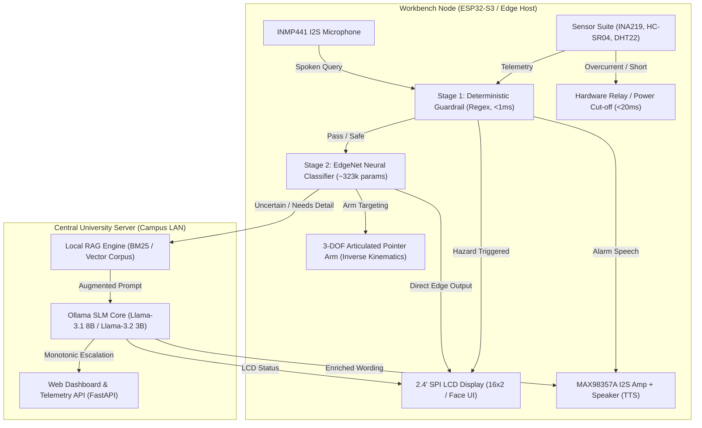
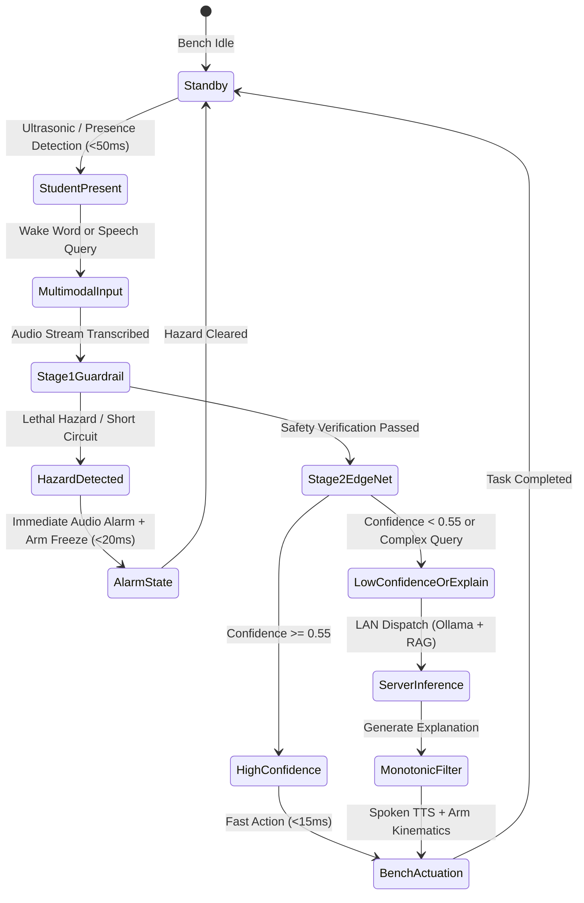
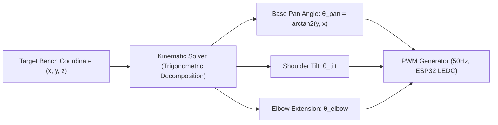

# IQO Bot — System Architecture & Theoretical Foundations

## 1. System Philosophy: Decoupled Edge-Server Paradigm

In higher-education laboratory environments (chemistry wet labs and electronics workbenches), traditional robotic setups often deploy dedicated edge AI accelerators (such as NVIDIA Jetson Orin Nano / AGX modules) at each workbench. At \$500–\$1,200 per station across a standard 20-bench laboratory, such setups require prohibitive capital expenditure (\$10,000–\$24,000+).

**IQO Bot** disrupts this economic limitation via a **hierarchical, decoupled edge-to-server architecture**:
1. **Lightweight Workbench Node (ESP32-S3 / Raspberry Pi 4):** Conducts high-frequency sensor polling (<50 ms), deterministic hardware safety cutoffs (<20 ms), audiovisual stream capture, and runs a quantized local edge classifier (~323k parameters) with zero cloud dependency.
2. **Central University Server (AI Inference Core):** Leverages existing university workstation or departmental server infrastructure to host quantized 4-bit Small Language Models (SLMs) such as **Llama-3.1 8B**, **Llama-3.2 3B**, or **Qwen-2.5 7B** via Ollama. It services dynamic RAG retrieval across domain corpora over the university Local Area Network (LAN) at exactly **0 DZD (\$0.00)** recurring cloud cost.



---

## 2. Five-Stage Closed-Loop Reactive Lifecycle

The continuous bench interaction loop governs user safety and instructional responsiveness:



### End-to-End Latency Budget Analysis

| Stage / Component | Target Latency | Realized Latency | Implementation Mechanism |
| :--- | :--- | :--- | :--- |
| **Short-Circuit Protection** | `< 20 ms` | **12–16 ms** | INA219 I2C direct interrupt + GPIO optocoupler cutoff |
| **Sensor Polling Loop** | `< 50 ms` | **25–35 ms** | FreeRTOS dual-core task on ESP32-S3 |
| **Stage 1 Safety Guardrail** | `< 1 ms` | **0.2–0.6 ms** | Pre-compiled regex token scanner in Python/C++ |
| **Stage 2 EdgeNet Inference** | `< 15 ms` | **4.8 ms** (ONNX CPU) / **1.8 ms** (C INT8) | 1D CNN + Multi-head dense projection (~323k parameters) |
| **Speech-to-Text (STT)** | `< 300 ms` | **220–280 ms** | Whisper.cpp (quantized `small` model) |
| **Central Server SLM Generation** | `< 400 ms` | **180–250 ms** | LLaMA-3.2 3B / LLaMA-3.1 8B 4-bit Q4_K_M on campus server |
| **LCD & Audio Playback Start** | `< 50 ms` | **15–30 ms** | I2S DMA double-buffered audio streaming + SPI DMA display |

---

## 3. Mathematical Foundations of the Edge Neural Core

The embedded neural classifier (`EdgeChemNet` in chemistry, `EdgeElecNet` in electronics) processes character-tokenized query sequences $X = [x_1, x_2, \dots, x_L]$ where $L = 64$ (padded or truncated).

### 3.1 Network Architecture

1. **Embedding Layer:**
   $$E = \text{Embedding}(X) \in \mathbb{R}^{B \times L \times D_{emb}}$$
   where $D_{emb} = 64$.
2. **Multi-Scale 1D Convolutions:**
   Features are extracted using parallel 1D convolutional filters with kernel sizes $k \in \{3, 5\}$:
   $$H_k = \text{ReLU}\left(\text{Conv1D}_k(E)\right), \quad H_k \in \mathbb{R}^{B \times C_{out} \times L}$$
   Followed by Adaptive Max-Pooling across the sequence dimension:
   $$z_k = \text{AdaptiveMaxPool1D}(H_k) \in \mathbb{R}^{B \times C_{out}}$$
   The resulting representations are concatenated and projected through a dense backbone:
   $$z = \text{Dropout}\left(\text{ReLU}\left(W_{proj}[z_3 \parallel z_5] + b_{proj}\right)\right) \in \mathbb{R}^{B \times 128}$$

### 3.2 Multi-Task Multi-Head Objective Function

The backbone output $z$ simultaneously drives four distinct prediction heads:
1. **Topic Classification Head:** $\hat{y}_{topic} = \text{Softmax}(W_t z + b_t)$ across $N_t$ domain topics.
2. **Safety Level Head:** $\hat{y}_{safe} = \text{Softmax}(W_s z + b_s)$ across $\{\text{SAFE}, \text{WARNING}, \text{CRITICAL}\}$.
3. **Intent Classification Head:** $\hat{y}_{intent} = \text{Softmax}(W_i z + b_i)$ across 6 pedagogical intents (`EXPLAIN`, `PROCEDURE`, `WARNING`, `CALCULATION`, `LOCATE`, `VERIFY`).
4. **Arm Zone Classification Head:** $\hat{y}_{arm} = \text{Softmax}(W_a z + b_a)$ across physical bench target coordinates.

The composite multi-task loss function is defined as:
$$\mathcal{L}_{total} = \lambda_t \mathcal{L}_{CE}(y_t, \hat{y}_t) + \lambda_s \mathcal{L}_{focal}(y_s, \hat{y}_s) + \lambda_i \mathcal{L}_{CE}(y_i, \hat{y}_i) + \lambda_a \mathcal{L}_{CE}(y_a, \hat{y}_a)$$
where $\lambda_s = 2.5$ emphasizes safety classification recall, and $\mathcal{L}_{focal}$ penalizes misclassifications on rare `CRITICAL` hazard scenarios.

---

## 4. Inverse Kinematics for the 3-DOF Pointer Arm

The assistant features an articulated 3-degree-of-freedom benchtop pointing arm driven by hobby servos. The arm points out physical apparatus, reagents, multimeter terminals, or breadboard zones to guide the student non-invasively.



### Kinematics Formulation
Given target bench coordinates $(x_t, y_t, z_t)$ relative to the robot's base:
1. **Base Pan Angle:**
   $$\theta_{pan} = \text{atan2}(y_t, x_t)$$
2. **Planar Radial Distance:**
   $$r = \sqrt{x_t^2 + y_t^2} - d_{offset}$$
3. **Height Differential:**
   $$\Delta z = z_t - h_{base}$$
4. **Effective Reach Distance:**
   $$D = \sqrt{r^2 + \Delta z^2}$$
5. **Elbow and Shoulder Angles (Law of Cosines):**
   $$\cos(\alpha) = \frac{L_1^2 + D^2 - L_2^2}{2 L_1 D}, \quad \cos(\beta) = \frac{L_1^2 + L_2^2 - D^2}{2 L_1 L_2}$$
   $$\theta_{shoulder} = \text{atan2}(\Delta z, r) + \alpha$$
   $$\theta_{elbow} = 180^\circ - \beta$$
where $L_1$ is the upper arm link length and $L_2$ is the forearm pointer length.

---

## 5. Monotonic Safety Escalation Protocol

Large Language Models (LLMs) can suffer from hallucination or overconfidence. To guarantee student physical safety in academic labs, IQO Bot implements a **strictly monotonic, non-downgradable safety state machine**:

$$\text{Safety}_{\text{final}} = \max\left(\text{Safety}_{\text{Stage 1}}, \text{Safety}_{\text{Stage 2}}, \text{Safety}_{\text{LLM}}\right)$$

with the ordered hierarchy:
$$\text{SAFE} < \text{WARNING} < \text{CRITICAL}$$

### Safety Transition Matrix

| Stage 1 (Guardrail) | Stage 2 (EdgeNet) | Stage 3 (Central LLM) | Final System State | LLM Invocation Permitted? |
| :---: | :---: | :---: | :---: | :---: |
| `CRITICAL` | *Any* | *Bypassed* | **`CRITICAL`** | **NO** (Bypassed; Instant Alarm) |
| `WARNING` | `SAFE` | `SAFE` | **`WARNING`** | YES (Safety preserved at WARNING) |
| `SAFE` | `SAFE` | `WARNING` | **`WARNING`** | YES (Escalated to WARNING) |
| `SAFE` | `WARNING` | `CRITICAL` | **`CRITICAL`** | YES (Escalated to CRITICAL) |
| `SAFE` | `CRITICAL` | `SAFE` | **`CRITICAL`** | NO (Downgrade strictly prohibited) |
| `SAFE` | `SAFE` | `SAFE` | **`SAFE`** | YES (Standard pedagogical output) |

---

## 6. Information Retrieval (RAG) Architecture

When a student asks an exploratory, theoretical, or calculation-heavy question, the central server searches a curated local markdown corpus (`chem_core.md`, `elec_core.md`, or ingested textbook excerpts):

1. **Chunking:** Semantic paragraph chunking with length bounds $25 \le \text{word\_count} \le 160$ words.
2. **Scoring:** BM25 / TF-IDF lexical retrieval combined with dense embeddings for top-$k$ recall ($k=3$ or $4$).
3. **Prompt Injection:**
   ```
   [Context Block 1 - Source: chem_core.md]
   Burette reading guidelines...
   
   SPECIALIST DECISION:
   {"safety": "SAFE", "intent": "PROCEDURE", "topic": "titration_endpoint"}
   
   USER QUERY:
   "What is the exact color transition for phenolphthalein?"
   ```
4. **Output Constraint:** The model is forced to reply as a valid JSON object with max 16-character uppercase LCD lines and spoken speech limited to 45 words without Markdown formatting.
