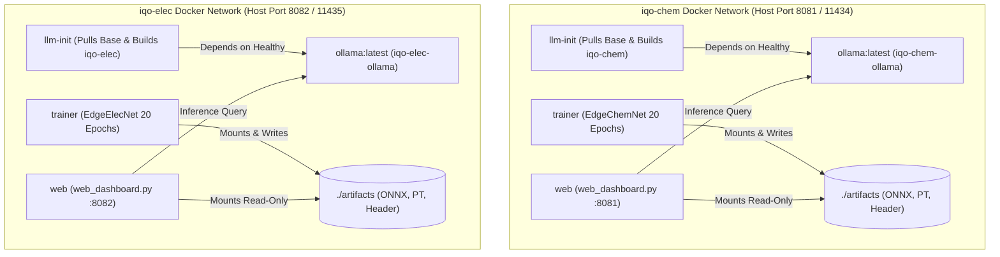

# IQO Bot — Docker AI & Container Infrastructure Guide

## 1. Containerized Multi-Tier AI Architecture

The IQO Bot platform provides containerized deployment pipelines for both domain specializations:
- **Chemistry Laboratory Assistant (`chem/`):** Docker project `iqo-chem` (Ollama model `iqo-chem`, web dashboard on port `8081`).
- **Electronics Workbench Assistant (`elec/`):** Docker project `iqo-elec` (Ollama model `iqo-elec`, web dashboard on port `8082`).
- **Unified / Central Brain (`root`):** Central chat coordinator connecting local RAG retrieval with upstream model runners.



---

## 2. Service Definitions & Composition

### 2.1 The Four Microservices
Each domain stack consists of four orchestratable Docker Compose services:

1. **`ollama`:**
   - Runs official `ollama/ollama:latest`.
   - Persists downloaded base model weights in a named Docker volume (`ollama:/root/.ollama`).
   - Built-in health check probes `ollama list` every 5 seconds.
2. **`llm-init`:**
   - One-shot initialization container that runs `/llm/init_llm.sh`.
   - Automatically pulls `${BASE_MODEL}` (default: `llama3.2:3b` for lightweight workstations, or `llama3.1:8b`).
   - If an optional LoRA adapter exists in `./llm/adapter`, injects `ADAPTER /llm/adapter` into the Modelfile.
   - Executes `ollama create <model-name> -f /tmp/Modelfile` to register the specialized persona and safety guardrails.
3. **`trainer` (`--profile train`):**
   - Multi-stage build based on `python:3.11-slim` with PyTorch CPU and ONNX runtime.
   - Synthesizes domain training data via `data_gen.py`.
   - Trains `EdgeChemNet` or `EdgeElecNet` for 20 epochs with early-stopping and learning rate scheduling.
   - Automatically executes `export.py` to write artifacts to `./artifacts/`:
     - `.pt` (TorchScript module)
     - `.onnx` (ONNX optimized graph)
     - `_quantized.pt` (Dynamic INT8 quantized PyTorch model)
     - `_embedded_config.h` (C header with int8 quantized weights and kinematics for ESP32-S3)
4. **`web` (`--profile run`):**
   - Launches a zero-dependency Python multi-threaded HTTP server (`web_dashboard.py`).
   - Serves an interactive dark-mode web user interface and REST API on port `8080` (mapped to `8081` for Chem, `8082` for Elec).
   - Evaluates queries through the 3-stage pipeline: Stage 1 Guardrail -> Stage 2 EdgeNet -> Stage 3 Ollama LLM.

---

## 3. Quickstart: Running with Docker Compose

### 3.1 Starting the Chemistry Assistant
```bash
# Navigate to the chemistry stack
cd chem

# 1. Start Ollama and initialize the specialized iqo-chem model
docker compose up -d

# 2. (Optional) Run the trainer to produce fresh artifacts in ./artifacts
docker compose --profile train run --rm trainer

# 3. Launch the web dashboard on http://localhost:8081
docker compose --profile run up -d web
```

### 3.2 Starting the Electronics Assistant
```bash
# Navigate to the electronics stack
cd elec

# 1. Start Ollama (maps host port 11435) and create iqo-elec
docker compose up -d

# 2. (Optional) Train EdgeElecNet and export embedded headers
docker compose --profile train run --rm trainer

# 3. Launch the web dashboard on http://localhost:8082
docker compose --profile run up -d web
```

---

## 4. Environment Variables & Hardware Configuration

Configure model options and hardware scaling using `.env` files or inline environment variables:

| Variable | Default Value | Description |
| :--- | :--- | :--- |
| `BASE_MODEL` | `llama3.2:3b` | Base model pulled by Ollama (`llama3.2:3b`, `llama3.1:8b`, `qwen2.5:7b`). |
| `OLLAMA_HOST` | `http://ollama:11434` | Target Ollama instance URL. Point to `host.docker.internal:11434` if running local Ollama. |
| `IQO_LLM_MODE` | `always` (`run`) / `fallback` | LLM invocation mode: `off` (edge only), `fallback` (when edge confidence < 0.55), `always`. |
| `IQO_ARTIFACTS`| `/artifacts` | Path to generated ONNX models and RAG index files. |
| `PORT` | `8080` | Container internal HTTP port for `web_dashboard.py`. |

### Enabling NVIDIA GPU Acceleration
To leverage dedicated NVIDIA GPUs inside the Ollama container for ultra-fast token generation:

1. Install [NVIDIA Container Toolkit](https://docs.nvidia.com/datacenter/cloud-native/container-toolkit/latest/install-guide.html).
2. Uncomment the `deploy` block in `chem/docker-compose.yml` or `elec/docker-compose.yml`:
   ```yaml
   ollama:
     image: ollama/ollama:latest
     deploy:
       resources:
         reservations:
           devices:
             - driver: nvidia
               count: all
               capabilities: [gpu]
   ```
3. Restart the stack:
   ```bash
   docker compose down && docker compose up -d
   ```

---

## 5. Domain Knowledge Ingestion & LoRA Fine-Tuning

### 5.1 Ingesting External Datasets for RAG
The `ingest_hf.py` utility downloads educational corpora directly from the Hugging Face hub, filtering and chunking texts for retrieval:
```bash
python ingest_hf.py \
  --repo CJJones/LLM_Electrical_Engineering_Educational_Synthetic_Dialog \
  --file circuit_conversations_Sample.txt \
  --out knowledge/ingested.md \
  --max-chunks 3000
```

### 5.2 Building SFT Datasets & LoRA Fine-Tuning
To specialize a base LLaMA model on the bot's deterministic JSON formatting rules:
```bash
# 1. Generate instruction dataset from synthetic topics
python finetune/build_sft.py
# Output: finetune/sft.jsonl

# 2. Run LoRA parameter-efficient fine-tuning (requires GPU with CUDA)
python finetune/lora_finetune.py \
  --base meta-llama/Llama-3.1-8B-Instruct \
  --data finetune/sft.jsonl \
  --out llm/adapter

# 3. Re-build the Ollama model (llm-init detects ./llm/adapter automatically)
docker compose restart llm-init
```
